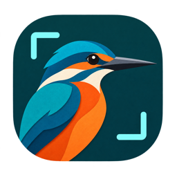
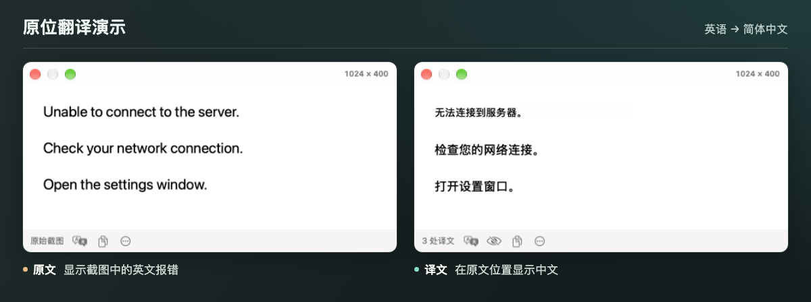
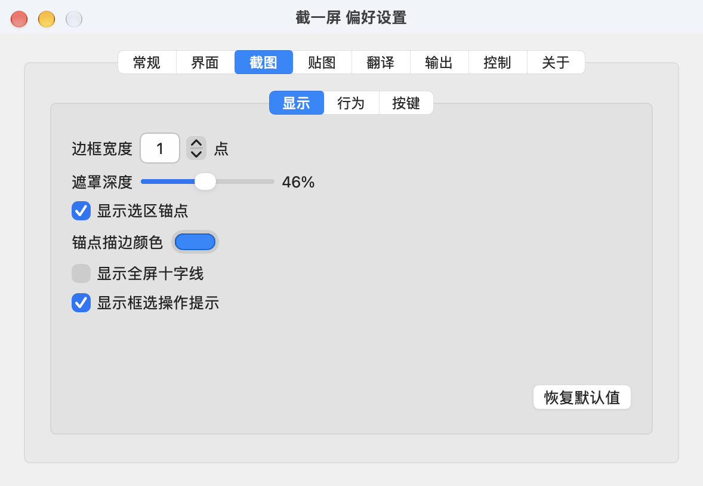
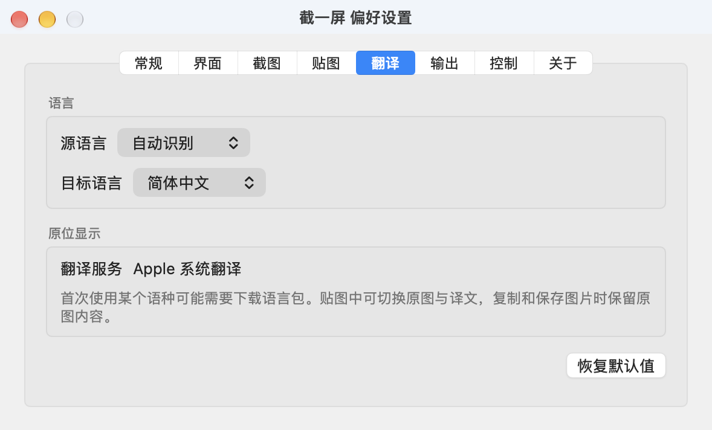
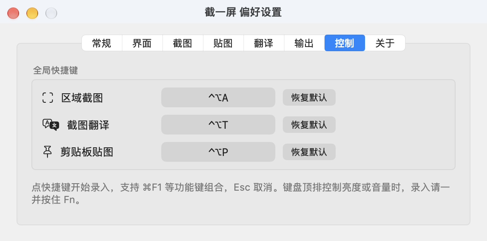

<p align="center">
  
</p>

<h1 align="center">截一屏</h1>

<p align="center"><strong>截下外文界面，直接在原处阅读译文。</strong></p>

<p align="center">
  截一屏（GrabOne）是 Mac 菜单栏截图工具。<br>
  框选后可添加标注、置顶贴图或翻译。
</p>

<p align="center">
  <a href="#从源码运行">在 Mac 上运行</a> ·
  <a href="#从选区到标注">使用指南</a> ·
  <a href="#偏好设置">偏好设置</a>
</p>

<picture>
  <source media="(max-width: 600px)" srcset="docs/images/translation-demo-mobile.png">
  
</picture>

演示使用合成报错样图，由本机语言包翻译。按 <kbd>⌃⌥T</kbd> 框选后，点眼睛图标切回原图。

## 从选区到标注

<p align="center">
  
</p>

- **圈出重点。** 在冻结画面中框选，可吸附窗口、按像素微调。用箭头指向报错，给字段加文字说明，或用马赛克遮住账号，再复制或保存为 PNG、JPEG。
- **把参考图留在桌面。** 截图和剪贴板里的图片都能贴在其他窗口上方。贴图可缩放、调透明度或开启鼠标穿透，方便一边操作一边对照。
- **分开复制文字和图片。** 从贴图菜单可以单独复制译文或 OCR 原文。复制、保存图片时保留原始画面及手动标注。

## 偏好设置

点击菜单栏的「文」图标，打开「设置…」。截图、贴图和翻译等设置可按页恢复默认值。

<p align="center">
  
</p>

- **界面与截图**可调整选区颜色、放大倍率、遮罩和窗口吸附。
- **贴图与输出**可设置贴图透明度、双击行为、图片格式与默认保存文件夹。
- **翻译与控制**可选择源语言和目标语言，也能给三个全局操作换上顺手的组合键，例如用 ⌘F1 框选截图。

<details>
<summary>查看翻译和快捷键设置</summary>

<p align="center">
  
</p>

<p align="center">
  
</p>

</details>

## 默认快捷键

| 快捷键 | 操作 |
| --- | --- |
| <kbd>⌃</kbd> <kbd>⌥</kbd> <kbd>A</kbd> | 区域截图 |
| <kbd>⌃</kbd> <kbd>⌥</kbd> <kbd>T</kbd> | 框选后直接进行原位翻译 |
| <kbd>⌃</kbd> <kbd>⌥</kbd> <kbd>P</kbd> | 将剪贴板图片贴到屏幕 |

三个全局快捷键都可以在菜单栏的「快捷键…」里修改。

<details>
<summary>框选和标注时还能用哪些键？</summary>

| 按键 | 操作 |
| --- | --- |
| <kbd>Tab</kbd> / <kbd>A</kbd> | 切换窗口吸附 / 选中当前显示器 |
| <kbd>方向键</kbd> / <kbd>⇧</kbd> <kbd>方向键</kbd> | 移动选区 / 调整选区宽高 |
| <kbd>Return</kbd> 或 <kbd>⌘</kbd> <kbd>C</kbd> | 复制截图 |
| <kbd>⌘</kbd> <kbd>S</kbd> | 保存截图 |
| <kbd>P</kbd> / <kbd>T</kbd> | 贴图 / 原位翻译 |
| <kbd>⌘</kbd> <kbd>Z</kbd> / <kbd>⇧</kbd> <kbd>⌘</kbd> <kbd>Z</kbd> | 撤销 / 重做标注 |
| <kbd>Esc</kbd> | 退出截图 |

</details>

## 从源码运行

当前版本为 **v0.2.2**。运行需 **macOS 15 或更新版本**，从源码构建需安装包含 macOS 15 或更新 SDK 的 Xcode Command Line Tools。

```bash
git clone https://github.com/cooper-dev-404/grabone.git
cd grabone
./Scripts/build.sh
open "dist/截一屏.app"
```

启动后，在菜单栏找到带取景角的「文」图标。第一次截图时按系统提示授予屏幕录制权限，必要时重新打开应用。第一次翻译某个语种时，系统可能提示下载语言包。

<details>
<summary>构建、实现与验证</summary>

构建脚本默认按本机架构编译并本地签名。可用 `GRABONE_ARCH` 指定单一目标架构。

应用使用 Swift、AppKit 和 SwiftUI。ScreenCaptureKit 负责采集屏幕，Vision 识别文字及坐标，Apple Translation 负责翻译。贴图窗口独立绘制译文，图片导出时只合成原始位图和手动标注。

运行 `./Scripts/check.sh` 可检查快捷键配置、Retina 裁剪、OCR 坐标、翻译取消、PNG 导出一致性及 JPEG 输出。实体键盘跨应用触发、真实桌面采集和外接显示器框选仍待实测。

更多细节见 [产品与交互](产品与交互.md)。

</details>
