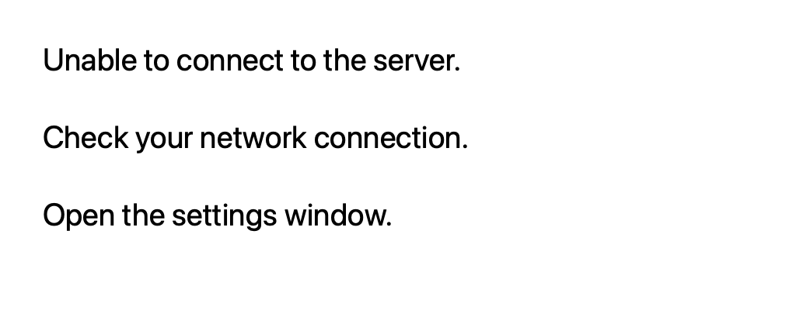
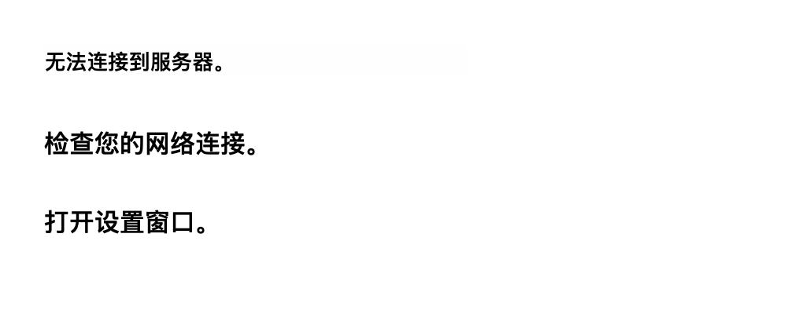

# 截一屏 · GrabOne

**macOS 菜单栏截图、贴图与原位翻译工具。**

截取一块屏幕，加上标注后复制、保存，或贴在桌面上随时对照。遇到外文界面时，译文会出现在截图中对应的文字位置。比如截下英文报错时，可以先在贴图里阅读中文，再把保留英文和标注的截图发给支持人员。

`macOS 15+` · `v0.2.2`

## 原位翻译示例

| 截图原文 | 贴图中的中文译文 |
| --- | --- |
|  |  |

上图使用合成的英文报错画面，译文由 Vision OCR 与 Apple 系统翻译生成。

按 **⌃⌥T** 框选外文，松开鼠标即生成贴图并开始翻译。点贴图上的眼睛图标可以切换原图和译文。复制或保存的图片保留原图内容与手动标注，译文可从贴图菜单单独复制。

## 主要功能

- **区域截图。** 在冻结的画面中框选，支持窗口吸附、选中当前显示器及按像素微调选区。
- **截图标注。** 支持矩形、椭圆、箭头、直线、画笔、荧光笔、马赛克和文字，可撤销与重做。
- **浮动贴图。** 将截图或剪贴板图片置顶，支持缩放、透明度和鼠标穿透。菜单栏可集中定位、隐藏或关闭贴图。
- **原位翻译。** 使用 Vision 识别图片文字，再由 Apple 系统翻译生成译文。支持自动识别源语言、停止与重试，以及单独复制 OCR 原文。
- **图片输出。** 支持复制到剪贴板和保存 PNG、JPEG。对已标注的贴图，也可单独复制或保存原图。

## 从源码构建

运行需 **macOS 15 或更高版本**。构建需安装包含 macOS 15 或更新 SDK 的 Xcode Command Line Tools。克隆仓库并在项目目录运行构建脚本。

```bash
git clone https://github.com/cooper-dev-404/grabone.git
cd grabone
./Scripts/build.sh
open "dist/截一屏.app"
```

脚本默认按本机架构构建，将本地临时签名的应用放在 `dist/截一屏.app`。可用 `GRABONE_ARCH` 指定单一目标架构。

启动后，点击菜单栏里带取景角的「文」图标。首次截图按提示授予屏幕录制权限，若系统提示退出，请重新打开应用。首次翻译某个语种时，系统可能提示下载语言包。

## 默认快捷键

| 快捷键 | 操作 |
| --- | --- |
| ⌃⌥A | 区域截图 |
| ⌃⌥T | 区域截图并原位翻译 |
| ⌃⌥P | 将剪贴板图片贴到屏幕 |

通过菜单栏的「快捷键…」可修改这三个组合。进入普通截图后，按 **Tab** 切换窗口吸附，按 **A** 选中当前显示器，用 **方向键** 移动选区，或用 **⇧＋方向键** 调整宽高。选好区域后，按 **Return** 或 **⌘C** 复制，按 **⌘S** 保存，按 **P** 贴图，按 **T** 翻译，按 **Esc** 退出。

## 实现与验证

应用以 Swift 编写，使用 AppKit 和 SwiftUI 构建界面。ScreenCaptureKit 获取屏幕画面，Vision 提供文字及坐标，Apple Translation 生成的译文由贴图窗口单独绘制。截图导出由原始位图和用户标注生成。

```bash
./Scripts/check.sh
```

回归检查覆盖功能键与旧快捷键配置读取、Retina 裁剪、Vision OCR 坐标映射、翻译取消、译文显示前后的 PNG 字节一致性及 JPEG 输出。

已用本机语言包验证英文样例的中文原位显示、原图切换和导出。实体键盘跨应用触发全局快捷键、真实桌面采集和外接显示器框选待实测。当前可在各显示器内单独框选。

更多交互细节见 [产品与交互](产品与交互.md)。
